<picture>
  <source media="(max-width: 600px)" srcset="assets/profile-narrow.svg">
  
</picture>

  
  
  

<b>Go for a walk</b>

<blockquote>

A trail leaves the bottom of the hill and forks at the first pine.

Take the path into the pines

<blockquote>

The trees close in and the light turns green. Water is running somewhere to your left. Something rustles to your right.

Follow the water

<blockquote>

A lake nobody told you about. You skip a stone. Five bounces.

Ending 1 of 4
</blockquote>

Follow the rustle

<blockquote>

A fox, mid-step, as surprised as you are. Neither of you says anything.

Ending 2 of 4
</blockquote>

</blockquote>

Climb toward the ridge

<blockquote>

It is steeper than it looked. Halfway up, the wind picks up.

Keep climbing

<blockquote>

The top. The clouds are below you now, and the sun is on its way out.

Ending 3 of 4
</blockquote>

Shelter behind the rocks

<blockquote>

You wait out the wind, light a small fire, and stay for the stars.

Ending 4 of 4
</blockquote>

</blockquote>

</blockquote>

