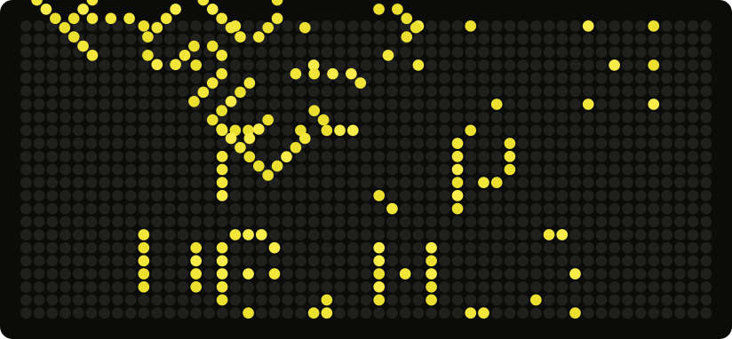

That is a flip-dot sign, the kind old buses carried. It turns over between my name, my last three years on GitHub, and the last thing I released. On the middle screen every disc is one day, lit if I pushed something. It rebuilds itself each morning from live data. [How it's made](scripts/build.mjs).

I'm a software engineer at Chatbyte GmbH. I build web apps, backends, and data and payment systems, and the tooling that keeps them running in production.

On the side I make small apps with Sriram at [Yeet Factory](https://github.com/yeetfactory):

- **[Déjà](https://github.com/yeetfactory/deja)** remembers the Bluetooth and Wi-Fi devices around you, and tells you when one comes back or seems to be following you.
- **[Recur](https://github.com/yeetfactory/recur)** is a local-first subscription tracker.

[rishikeshs.net](https://rishikeshs.net) · [LinkedIn](https://www.linkedin.com/in/rishikeshs/) · [Email](mailto:rkesh2003@gmail.com)
